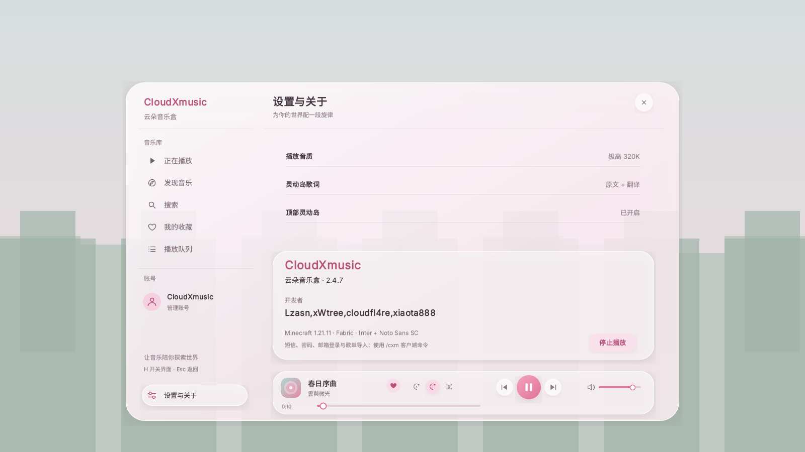

# 云朵音乐盒 · CloudXMusic

<p align="center">
  
</p>

<p align="center">
  <strong>把音乐带进方块世界</strong><br>
  Minecraft Java Edition 的 Fabric 客户端音乐播放器
</p>

<p align="center">
  
  
  
  
  
</p>

<p align="center">
  
</p>

<p align="center"><sub>白粉磨砂界面 · 自定义字体 · 游戏内灵动岛</sub></p>

## 目录

[功能](#功能) · [安装](#安装) · [使用](#使用) · [构建](#构建) · [配置与隐私](#配置与隐私) · [已知限制](#已知限制) · [开发资料](#开发资料)

## 项目简介

CloudXMusic（云朵音乐盒）是一款面向 Minecraft 1.21.11 的 Fabric 客户端模组，提供游戏内音乐库、网易云音乐接入、歌词与独立 HUD 灵动岛。界面使用模组内置字体和抗锯齿画布绘制。

开发者：Lzasn、xWtree、xiaota888。

> **首次使用说明**：首次使用时须在游戏内阅读并确认免责声明。CloudXMusic 是非官方第三方客户端，与网易云音乐及其运营方无隶属、授权或背书关系。服务请求由客户端直接发送至网易云音乐相关服务及音频 CDN。登录 Cookie 以未加密文本保存在本机，请勿分享；使用时请遵守服务条款、所在地法律法规及作品版权要求。

## 功能

| 音乐与账号 | 播放与界面 |
| --- | --- |
| 网易云用户名密码、短信验证码、Cookie 登录 | 播放队列、单曲循环、列表循环与随机播放 |
| 每日推荐、歌曲/歌手搜索、收藏 | 进度和音量控制，播放状态与队列持久化 |
| 标准、较高、极高与无损四档音质 | 滚动歌词、原文/双语模式与游戏内灵动岛 |
| 专辑封面与当前歌曲信息 | 独立字体、圆角磨砂界面与低对比柔和阴影 |

首次确认免责声明前不会发起网易云 API 或封面请求。模组不会把登录 Cookie 保存在项目服务器上。

## 安装

1. 使用 Minecraft `1.21.11`，安装 Fabric Loader `0.18.1` 或更新版本及 Fabric API。
2. 将 `CloudXMusic-<version>.jar` 放入游戏实例的 `mods/` 目录。
3. 启动游戏，按 `H` 打开云朵音乐盒；首次打开时确认免责声明。

播放使用 `javax.sound.sampled`，Java 运行时需包含 `java.desktop` 模块。官方启动器提供的 Microsoft/OpenJDK 通常满足要求。

## 使用

默认是按 `H` 打开或关闭音乐盒。界面内可切换正在播放、发现、搜索、收藏、队列、账号和设置页面，登录、搜索、收藏、音质切换等全部在界面内完成，无需命令。

## 构建

需要 Java 21 和网络连接，以下载 Minecraft、Fabric 与编译依赖。

Windows：

```powershell
.\gradlew.bat :cloudxmusic-client:build
```

Linux/macOS：

```bash
./gradlew :cloudxmusic-client:build
```

构建产物位于 `cloudxmusic-client/build/libs/CloudXmusic-<version>.jar`。

## 配置与隐私

配置目录：`config/cloudxmusic/`

| 文件 | 内容 |
| --- | --- |
| `cookies.json` | 网易云登录 Cookie 与游客会话 Cookie，未加密保存 |
| `netease.json` | 昵称、UID、音质与歌词偏好 |
| `state.json` | 当前歌曲与播放队列 |

- Cookie 仅保存于本机客户端，并会随网易云请求发送至网易云相关服务。
- 请勿上传、截图或分享 `cookies.json`；退出登录会清理本地 Cookie。
- 不要把账号密码、Cookie 或音频凭证提交到 Git 仓库或公开工单。

## 已知限制

- 支持标准、较高、极高（MP3）与无损（FLAC）四档音质；Hi-Res 尚未接入，无损需账号具备相应权限。
- 网易云接口为非官方接口，可能随服务端变化而失效。
- 部分受版权、地区或账号权限限制的曲目可能无法播放。
- 当前仓库实现客户端功能；Folia 多人音乐房间及客户端/服务端协议尚未实现。

## 开发资料

- [UI 知识点与维护约定](UI_KNOWLEDGE.md)
- [UI 重构记录](UI_REFACTOR.md)
- [开发状态与交接记录](DEVELOPMENT_STATUS.md)
- [第三方组件与许可证](THIRD_PARTY_NOTICES.md)

主要代码位于 `cloudxmusic-client/src/main/java/dev/lzasn/cloudxmusic/client/`：`audio/` 处理音频，`gui/` 绘制界面，`hud/` 绘制灵动岛，`lyric/` 解析歌词，`netease/` 处理登录与 API，`state/` 管理播放状态。

## 第三方组件与许可证

- [JLayer](https://repo1.maven.org/maven2/javazoom/jlayer/)：MP3 解码，LGPL-3.0-or-later。
- [ZXing Core](https://github.com/zxing/zxing)：二维码编码，Apache-2.0。
- [jFLAC](https://repo1.maven.org/maven2/org/jflac/jflac-codec/)：FLAC 无损解码，LGPL-2.1。
- Inter 与 Noto Sans SC 字体的许可证随资源一并提供。

完整声明见 [THIRD_PARTY_NOTICES.md](THIRD_PARTY_NOTICES.md)。项目原创代码采用 [GNU GPL-3.0-only](LICENSE)；版权归 Lzasn、xWtree、xiaota888 所有。
